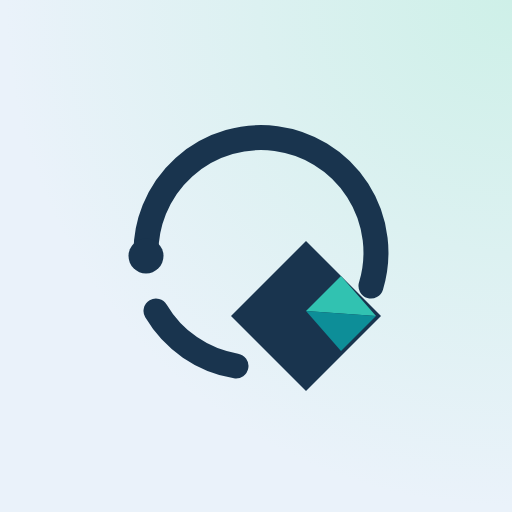
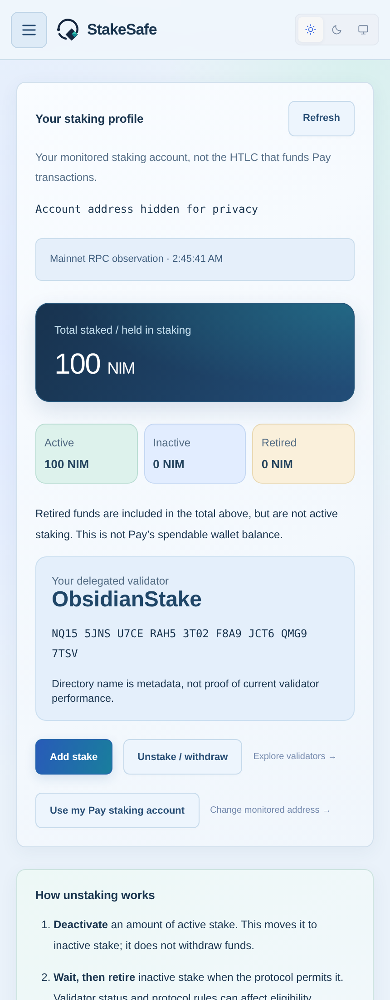
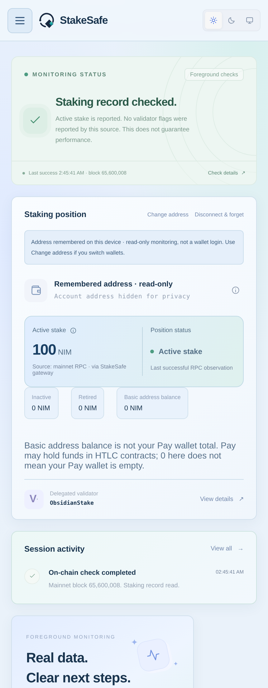
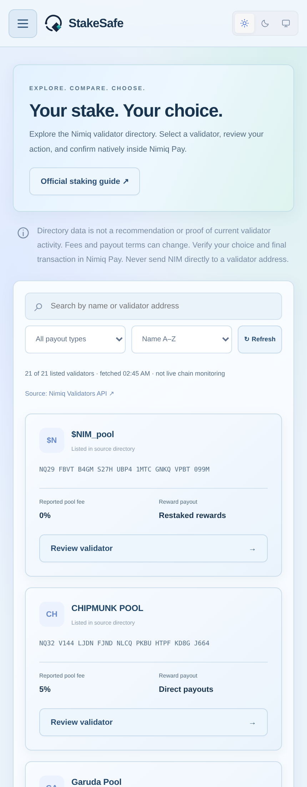
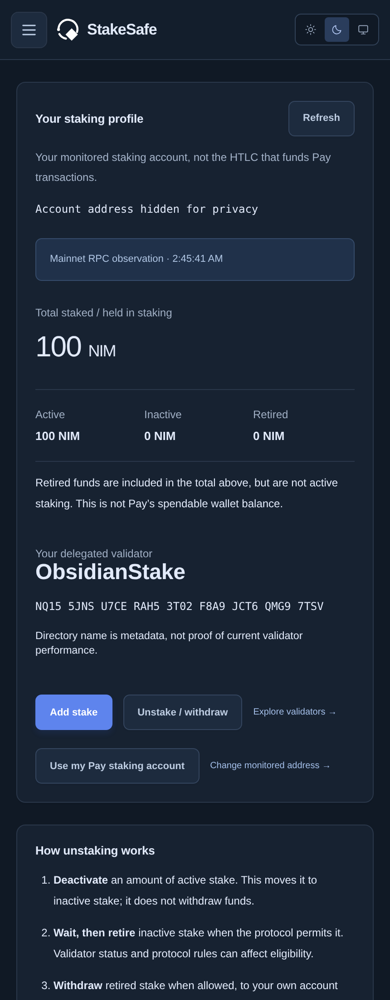

<p align="center"></p>

# StakeSafe

**Staking, in sight.** A Nimiq Pay mini app for checking your mainnet staking position, finding validators, and reviewing native staking actions in one place.

**[Open StakeSafe](https://stakesafe-kappa.vercel.app)** · [Privacy](https://stakesafe-kappa.vercel.app/privacy.html) · [Security](SECURITY.md)

## What you can do

- **See your staking profile:** total held in staking, active/inactive/retired balances, and the delegated validator’s name and address.
- **Explore validators:** search the public directory and compare reported fees and payout terms.
- **Act inside Nimiq Pay:** review new staking, add stake, change delegation, or separately deactivate, retire and withdraw eligible stake. Each transaction requires native confirmation.
- **Monitor a public address:** refresh manually or use foreground checks every 60 seconds. Optionally remember the address without repeating account-sharing prompts on reload.
- **Choose your view:** Light, Dark or System theme, with mobile-friendly navigation.

## Screenshots

Live mainnet browser captures. Account addresses are redacted for privacy; balances are not fabricated. These show StakeSafe’s interface, not native wallet approval screens. Validator names and terms are third-party metadata, not endorsements.

| Staking profile · Light | Overview · Light |
|:---:|:---:|
|  |  |
| **Validator directory** | **Staking profile · Dark** |
|  |  |

## Use inside Nimiq Pay

1. Open **Nimiq Pay → Mini Apps → Custom URL** and enter `https://stakesafe-kappa.vercel.app`.
2. Connect to monitor an address, or open **Profile → Use my Pay staking account**. Review the data-source consent and any native account-check message. An account-check signature is not a transaction.
3. Review your profile and validator. Choose an action, check its amount and details, then approve or cancel in Pay.

If Custom URL is unavailable, update Pay or consult its current instructions. A regular browser can monitor a public address but cannot provide native Pay signing.

## Important boundaries

- **Your keys stay in Pay.** StakeSafe never asks for a seed phrase/private key and its server never signs or submits transactions. Check the selected wallet, staking identity, action, validator, amount, mainnet and actual fee in Pay before approving.
- **A basic address balance is not the Pay wallet total.** Pay may hold funds in HTLC contracts while the owner address shows 0. StakeSafe does not use that zero to block staking; Pay validates available funds and fees. The funding address can differ from the staking owner.
- **Unstaking is staged:** deactivate → wait until eligible → retire → withdraw. Each step is separate; nothing advances automatically and no instant withdrawal or fixed unlock time is promised.
- **A hash is not confirmation.** Read-only transaction checks report matched mined execution and observed staking changes, not an independent finality guarantee. Pending or unknown requests are not automatically retried. Resolved prior receipts do not permanently block a fresh review.
- **Monitoring is foreground-only.** No background service, push notifications, guaranteed rewards or validator safety ratings. Failed reads retain labeled last-known values instead of fake zero balances.

## Run locally

Node.js 20+:

```sh
npm ci
npm start
# http://localhost:3000 — builds the app and serves its read-only RPC gateway
```

With the local server running, use a second terminal:

```sh
npx playwright install --with-deps chromium
npm test
```

Automated tests cover monitoring, native request flows with mocked hosts/RPC, transaction guards, themes and responsive layouts. Mocks are not proof of physical-device compatibility; verify native approval and timing-dependent unstaking on your device.

## Build

```sh
npm run build
```

Deploy `dist/` together with the Vercel function `api/rpc.js` and `vercel.json`. Static-only hosting is insufficient. The gateway forwards only fixed, allowlisted mainnet reads; no app credentials are required. Tests, screenshots and repository documents are not included in the runtime build.

## License and credits

[MIT](LICENSE). See [attributions](ATTRIBUTIONS.md) and [third-party license notices](THIRD_PARTY_NOTICES.txt).

StakeSafe is independent, not an official Nimiq service or a validator endorsement.
